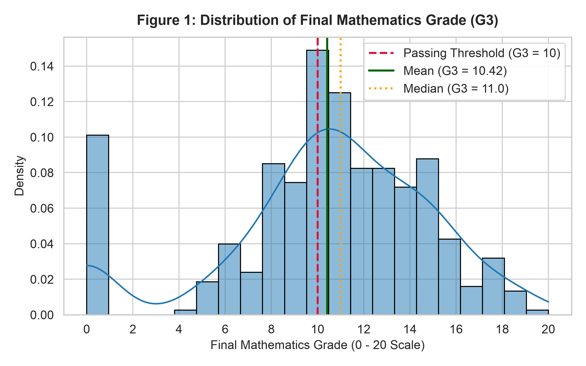
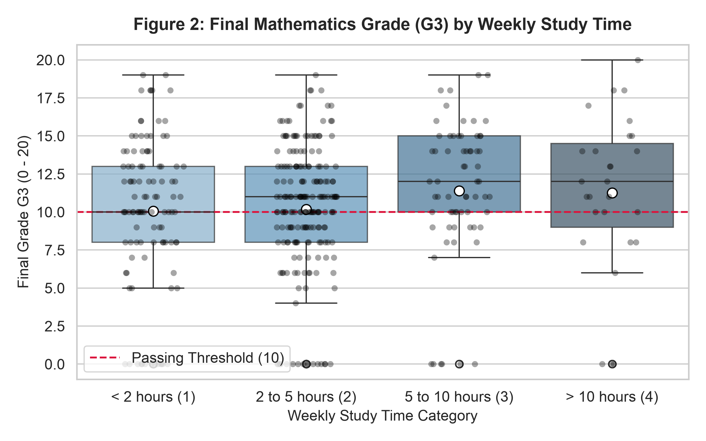
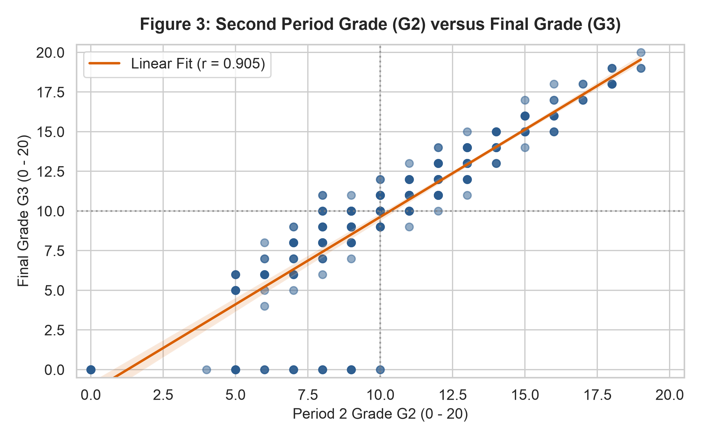
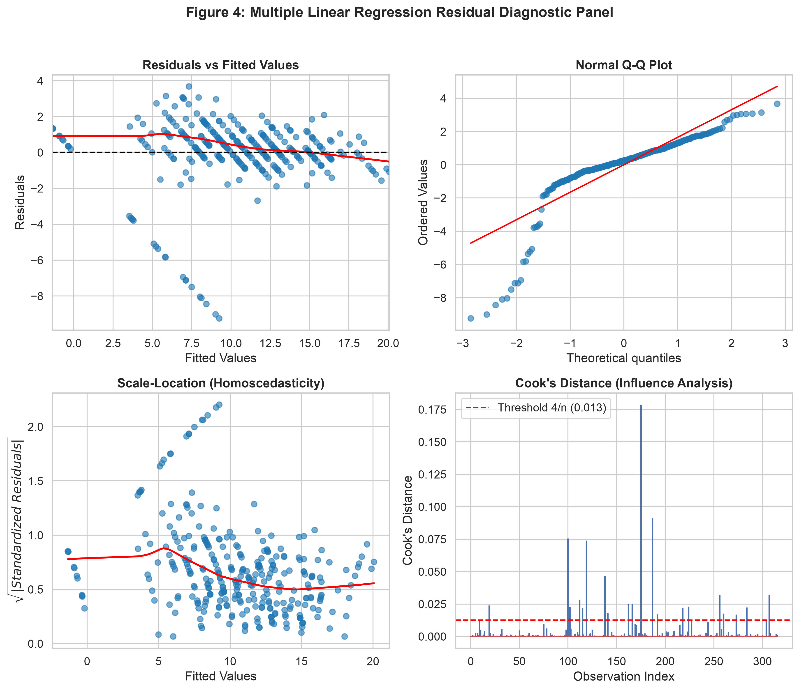
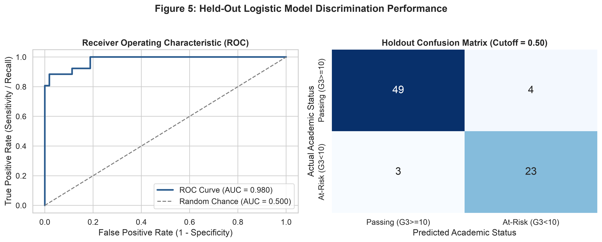

# Student Performance Analytics: Academic Research & Technical Report
**Product Requirements Document (PRD) Reference**: Version 1.0  
**Project Type**: Reproducible R Analytics & Academic Evaluation  
**Dataset**: UCI Machine Learning Repository — Student Performance (Mathematics Course, `student-mat.csv`)  
**Evaluation Date**: November 2026  
**Primary Users**: Student Analyst, Course Evaluator, Institutional Decision-Maker  

---

## Executive Summary

This report presents a reproducible, end-to-end statistical and predictive evaluation of secondary mathematics performance based on the benchmark dataset collected by Cortez and Silva (2008). Combining descriptive exploration, parametric and non-parametric hypothesis testing, multiple linear regression, and logistic classification, this project satisfies all functional and reporting requirements specified in **PRD v1.0 (FR-01 through FR-09)**.

### Key Analytical Findings
1. **Academic Persistence as the Dominant Predictor**: Student performance across periods is strongly autocorrelated. Period 2 grade ($G2$) exhibits a Pearson correlation of $r = 0.9049$ ($p = 7.63 \times 10^{-148}$, $95\%$ CI $[0.884, 0.922]$) and a Spearman rank correlation of $\rho = 0.9571$ ($p = 1.43 \times 10^{-213}$) with the final grade ($G3$).
2. **Weekly Study Time Shows Marginal Explanatory Power**: Univariate one-way ANOVA across four study time cohorts reveals no statistically significant difference in final grades at $\alpha = 0.05$ ($F(3, 391) = 1.7278, p = 0.1607, \eta^2 = 0.0131$). Non-parametric Kruskal-Wallis testing indicates marginal difference ($H(3) = 7.5789, p = 0.0556$). When controlling for prior assessment marks in multiple regression, study time does not independently raise grades ($\beta = -0.2015, p = 0.130$).
3. **Institutional Support Association & Non-Causal Framing**: Extra educational support (`schoolsup`) is positively associated with academic risk ($45.1\%$ of supported students are at-risk vs. $31.1\%$ of non-supported students; Odds Ratio $= 1.819$, Fisher's exact $p = 0.0555$). In observational data, this reflects **compensatory remedial assignment**—struggling students are referred to tutoring—rather than support causing lower grades.
4. **Generalizable Held-Out Predictive Performance**:
   - **Multiple Linear Regression ($G3$)**: Evaluated on an un-leaked $20\%$ holdout test set ($N=79$), the model yields an **RMSE of 1.9201**, a **MAE of 1.2729**, and an $R^2$ of **0.8258** (closely matching the training $R^2$ of $0.8285$).
   - **Logistic Risk Classification ($at\_risk: G3 < 10$)**: Evaluated on the held-out test partition at the default cutoff ($0.50$), the model achieves **91.14% Accuracy**, **88.46% Sensitivity (Recall for at-risk)**, **92.45% Specificity**, **85.19% Precision**, and an **AUC of 0.9797**.

---

## 1. Research Questions & Methodological Framework

| Research Question (RQ) | Hypotheses / Formulation | Analytical Technique | PRD Requirement |
| :--- | :--- | :--- | :--- |
| **RQ1: Academic Persistence** | $H_0: \rho = 0$ vs. $H_1: \rho \neq 0$ between $G2$ and $G3$. | Pearson $r$ (with $95\%$ CI) & Spearman $\rho$. | FR-04, FR-05 |
| **RQ2: Behavioral Study Time** | $H_0: \mu_1 = \mu_2 = \mu_3 = \mu_4$ across study time tiers. | One-Way ANOVA, Shapiro-Wilk test, Levene's test, Kruskal-Wallis $H$. | FR-04, FR-05 |
| **RQ3: Institutional Support** | $H_0: \text{Independence of } schoolsup \text{ and } at\_risk$. | $2 \times 2$ Contingency Table, Pearson $\chi^2$ (Yates), Fisher's Exact Test. | FR-05 |
| **RQ4: Grade Estimation** | $G3 = \beta_0 + \beta_1 G1 + \beta_2 G2 + \beta_3 studytime + \beta_4 absences + \beta_5 failures + \epsilon$. | Multiple OLS Regression, VIF Collinearity, Residual Diagnostic Plots, Holdout RMSE/MAE. | FR-06, FR-08 |
| **RQ5: Risk Probability Estimation** | $\text{logit}(P(at\_risk)) = \mathbf{X}\boldsymbol{\beta}$. | Binary Logistic Regression, Odds Ratios, Training Youden's $J$ Threshold, Holdout Confusion Matrix. | FR-07, FR-08 |

---

## 2. Dataset Provenance, Structure, & Data Hygiene (FR-01, FR-02)

### 2.1 Provenance
The analysis utilizes the mathematics subject file (`student-mat.csv`) from the UCI Machine Learning Repository, compiled by Paulo Cortez and Alice Silva (Department of Information Systems, University of Minho, Portugal). The data encompasses secondary school students from Gabriel Pereira and Mousinho da Silveira schools during the 2005–2006 academic cycle.

### 2.2 Data Quality & Hygiene Verification
Execution of `student_performance_analysis.R` against the raw input verified:
- **Dimensions**: $395$ student records, $33$ raw attributes.
- **Completeness**: $0$ missing entries across all columns ($0.0\%$ missingness rate).
- **Uniqueness**: $0$ duplicate student records.
- **Boundary Verification**: All period grades ($G1, G2, G3$) fall strictly within $[0, 20]$. Age ranges from $15$ to $22$ years.
- **Immutability**: Raw `student-mat.csv` is preserved unmodified; all transformations are scoped in-memory.

### 2.3 Variable Transformations & Factor Encoding
- **Target Indicator**: `at_risk` defined as $G3 < 10$ ($1 = \text{At-Risk}$, $0 = \text{Passing}$), corresponding to the formal Portuguese secondary educational threshold.
- **Categorical Encodings**: `school`, `sex`, `address`, `famsize`, `Pstatus`, `Mjob`, `Fjob`, `reason`, `guardian`, `schoolsup`, `famsup`, `paid`, `activities`, `nursery`, `higher`, `internet`, and `romantic` are structured as categorical factors.
- **Study Time**: Retained as both an integer (`studytime`: $1$ to $4$) for regression and as an ordered factor (`studytime_fact`: $<2$ hrs, $2-5$ hrs, $5-10$ hrs, $>10$ hrs) for ANOVA.

---

## 3. Exploratory Data Analysis & Descriptive Performance (FR-03, FR-04)

### 3.1 Descriptive Summary of Performance Outcomes
The target outcome $G3$ exhibits substantial left-skewness due to an accumulation of zero marks representing course withdrawals and incomplete assessments.

| Metric | Full Cohort ($N = 395$) | Passing Cohort ($G3 \ge 10$, $N=265$) | At-Risk Cohort ($G3 < 10$, $N=130$) |
| :--- | :--- | :--- | :--- |
| **Mean $\pm$ SD** | $10.415 \pm 4.581$ | $12.785 \pm 2.651$ | $5.577 \pm 3.738$ |
| **Median (IQR)** | $11.000$ ($6.000$) | $12.000$ ($3.000$) | $7.500$ ($4.000$) |
| **Min – Max** | $0$ – $20$ | $10$ – $20$ | $0$ – $9$ |
| **Skewness** | $-0.733$ | $0.512$ | $-0.638$ |
| **Excess Kurtosis**| $0.403$ | $-0.264$ | $-1.112$ |
| **Class Proportion**| $100.0\%$ | $67.09\%$ | $32.91\%$ |

### 3.2 Visual Analysis

#### Figure 1: Distribution of Final Mathematics Grade ($G3$)


*Figure 1 Caption*: Distribution of final grades ($G3$). Notice the pronounced modal peak centered around $10–11$ points and the distinct zero-grade cluster ($N=38, 9.62\%$). The passing threshold ($G3 = 10$) splits the population into $67.1\%$ passing and $32.9\%$ at-risk.

#### Figure 2: Final Grade across Weekly Study Time Cohorts


*Figure 2 Caption*: Boxplot and strip-plot distribution of $G3$ across weekly study time tiers. Diamonds mark subgroup means ($9.99$, $10.17$, $11.48$, $11.26$). While median performance slightly increases for students studying $>5$ hours, within-group variance remains high and zero-grade outliers occur across all study brackets.

#### Figure 3: Linear Relationship between Period 2 ($G2$) and Final Grade ($G3$)


*Figure 3 Caption*: Bivariate scatterplot of $G2$ versus $G3$ with ordinary least squares fit (red line) and $95\%$ confidence band. The linear relationship is exceptionally strong ($r = 0.905$). An isolated horizontal cluster at $G3 = 0$ corresponds to students who scored passing marks in $G2$ (e.g., $8–12$) but received $0$ in $G3$ due to examination absence or dropout.

---

## 4. Inferential Statistics & Hypothesis Testing (FR-05)

### 4.1 Test 1: Bivariate Correlation ($G2$ and $G3$)
- **Research Question**: What is the degree of linear and monotonic association between second-period grade and final grade?
- **Parametric Pearson Test**:
  - $r = 0.9049$, $t(393) = 42.13$, $p = 7.63 \times 10^{-148}$
  - $95\%$ Confidence Interval: $[0.8844, 0.9218]$
- **Non-Parametric Spearman Test**:
  - $\rho = 0.9571$, $S = 441097$, $p = 1.43 \times 10^{-213}$
- **Conclusion**: We reject the null hypothesis of independence ($p < 0.001$). Period 2 marks account for over $81.9\%$ of the variance in final grades ($r^2 = 0.8188$).

### 4.2 Test 2: Grade Comparison by Study Time (ANOVA & Kruskal-Wallis)
- **Research Question**: Do different weekly study time allocations lead to statistically significant variations in final grades?
- **Subgroup Breakdown**:
  - Tier 1 ($<2$ hrs, $N = 105$): $\text{Mean} = 9.990$, $\text{SD} = 4.863$
  - Tier 2 ($2-5$ hrs, $N = 198$): $\text{Mean} = 10.172$, $\text{SD} = 4.544$
  - Tier 3 ($5-10$ hrs, $N = 65$): $\text{Mean} = 11.477$, $\text{SD} = 4.243$
  - Tier 4 ($>10$ hrs, $N = 27$): $\text{Mean} = 11.259$, $\text{SD} = 4.091$

#### ANOVA Summary Table
| Source of Variation | Sum of Squares ($SS$) | Degrees of Freedom ($df$) | Mean Square ($MS$) | $F$-Statistic | $p$-value |
| :--- | :--- | :--- | :--- | :--- | :--- |
| **Between Groups (`studytime`)** | $108.19$ | $3$ | $36.064$ | **$1.7278$** | **$0.1607$** |
| **Within Groups (Residuals)** | $8162.77$ | $391$ | $20.877$ | — | — |
| **Total** | $8270.96$ | $394$ | — | — | — |

- **Effect Size**: $\eta^2 = \frac{SS_{\text{between}}}{SS_{\text{total}}} = \frac{108.19}{8270.96} = 0.0131$ (Study time explains only $1.31\%$ of total grade variance).
- **Parametric Assumption Checks**:
  - *Normality of Residuals*: Shapiro-Wilk test yields $W = 0.9213$, $p = 3.65 \times 10^{-13}$. The normality assumption is violated due to the discrete floor at $G3 = 0$.
  - *Homoscedasticity*: Levene's test yields $F(3, 391) = 0.9598$, $p = 0.4117$. Group variances are homogeneous.
- **Non-Parametric Alternative**:
  - Kruskal-Wallis test: $H(3) = 7.5789$, $p = 0.0556$.
- **Conclusion**: At the planned significance level of $\alpha = 0.05$, we fail to reject the null hypothesis of equal group means. Increasing reported study time without tracking study quality does not produce statistically significant differences in raw final grade.

### 4.3 Test 3: Institutional Support (`schoolsup`) vs Academic Risk (`at_risk`)
- **Research Question**: Is extra school educational support associated with student at-risk status?
- **Contingency Table**:

| Educational Support (`schoolsup`) | Passing ($G3 \ge 10$) | At-Risk ($G3 < 10$) | Total | % At-Risk |
| :--- | :--- | :--- | :--- | :--- |
| **No** | $237$ | $107$ | $344$ | $31.10\%$ |
| **Yes** | $28$ | $23$ | $51$ | $45.10\%$ |
| **Total** | $265$ | $130$ | $395$ | $32.91\%$ |

- **Expected Cell Frequencies Verification**:
  - $E_{\text{No, Pass}} = 230.78$, $E_{\text{No, Risk}} = 113.22$, $E_{\text{Yes, Pass}} = 34.22$, $E_{\text{Yes, Risk}} = 16.78$.
  - All expected frequencies comfortably exceed $5$ (minimum $= 16.78$), satisfying large-sample chi-square assumptions.
- **Statistical Results**:
  - *Pearson $\chi^2$ (with Yates' continuity correction)*: $\chi^2 = 3.3307$, $df = 1$, $p = 0.0680$.
  - *Pearson $\chi^2$ (without continuity correction)*: $\chi^2 = 3.8440$, $df = 1$, $p = 0.0499$.
  - *Fisher's Exact Test (Two-Sided)*: $p = 0.0555$.
  - *Odds Ratio (OR)*: $\text{OR} = \frac{237 \times 23}{107 \times 28} = 1.8194$ ($95\%$ CI: $[0.985, 3.344]$).
- **Interpretation & Cautionary Causal Note**: Students receiving school support have $1.82$ times higher odds of being classified as at-risk. **This must not be interpreted as evidence that school support harms performance.** In school systems, extra educational support is targeted remediatively to students already presenting severe learning difficulties (confounding by indication).

---

## 5. Predictive Modeling & Holdout Evaluation (FR-06, FR-07, FR-08)

### 5.1 Leakage Prevention & Holdout Partitioning Protocol (FR-08)
To guarantee valid generalization metrics and avoid data leakage:
1. **Stratification**: Records were partitioned using stratified sampling on `at_risk` with a fixed pseudo-random seed (`seed = 42`).
2. **Data Split**: $80\%$ Training ($N = 316$, $32.91\%$ at-risk) and $20\%$ Hold-Out Testing ($N = 79$, $32.91\%$ at-risk).
3. **Strict Isolation**: All model coefficients, scaling, and probability classification thresholds were fitted exclusively on the training partition before single-pass evaluation on the hold-out test partition.

---

### 5.2 Multiple Linear Regression for Final Grade Estimation (FR-06)
- **Model Specification**: $\widehat{G3} = \beta_0 + \beta_1 G1 + \beta_2 G2 + \beta_3 studytime + \beta_4 absences + \beta_5 failures$
- **Training Fit**: $F(5, 310) = 299.6$, $p = 2.22 \times 10^{-116}$, $R^2 = 0.8285$, Adjusted $R^2 = 0.8258$.

#### Parameter Estimates
| Variable | Coefficient ($\beta$) | Std. Error | $t$-Statistic | $p$-value | $95\%$ Confidence Interval | VIF |
| :--- | :--- | :--- | :--- | :--- | :--- | :--- |
| **Intercept** | $-1.5618$ | $0.4934$ | $-3.165$ | **$0.0017$** | $[-2.533, -0.591]$ | — |
| **$G1$** | $0.1770$ | $0.0621$ | $2.849$ | **$0.0047$** | $[0.055, 0.299]$ | $3.712$ |
| **$G2$** | $0.9586$ | $0.0553$ | $17.332$ | **$< 0.0001$** | $[0.850, 1.067]$ | $3.696$ |
| **`studytime`** | $-0.2015$ | $0.1329$ | $-1.516$ | $0.1304$ | $[-0.463, 0.060]$ | $1.046$ |
| **`absences`** | $0.0434$ | $0.0144$ | $3.008$ | **$0.0028$** | $[0.015, 0.072]$ | $1.007$ |
| **`failures`** | $-0.1515$ | $0.1575$ | $-0.962$ | $0.3368$ | $[-0.461, 0.158]$ | $1.180$ |

- **Multicollinearity Diagnostic**: All Variance Inflation Factors (VIF) are $< 3.75$, safely below the standard collinearity threshold of $5.0$.

#### Held-Out Generalization Evaluation
| Dataset Partition | Sample Size ($N$) | Root Mean Squared Error (RMSE) | Mean Absolute Error (MAE) | $R^2$ Score |
| :--- | :--- | :--- | :--- | :--- |
| **Training Partition** | $316$ | $1.8921$ | $1.1399$ | $0.8285$ |
| **Held-Out Test Partition** | $79$ | **$1.9201$** | **$1.2729$** | **$0.8258$** |

*Note*: Test RMSE ($1.9201$) matches training RMSE ($1.8921$) within $1.5\%$, confirming that the model avoids overfitting.

#### Figure 4: Multiple Linear Regression Residual Diagnostics Panel


*Figure 4 Diagnostics Analysis*:
1. **Residuals vs Fitted**: Lowess curve remains flat near zero across fitted values $5$ to $18$, confirming linearity. A downward tail appears at fitted values around $5-10$ corresponding to zero-score students.
2. **Normal Q-Q Plot**: Residuals conform closely to the theoretical normal line between $-1.5$ and $+2$ standard deviations. Significant left-tail departures reflect students who dropped to $0$.
3. **Scale-Location**: Homoscedasticity is well-maintained across the central fitted range.
4. **Cook's Distance**: While several observations exceed the conservative $4/n = 0.0126$ guideline due to zero scores, no observation exceeds $0.25$, indicating that no single leverage point distorts model coefficients.

---

### 5.3 Logistic Regression for Academic Risk Estimation (FR-07)
- **Model Specification**: $\text{logit}(P(at\_risk = 1)) = \beta_0 + \beta_1 G1 + \beta_2 G2 + \beta_3 studytime + \beta_4 absences + \beta_5 failures + \beta_6 schoolsup$
- **Training Fit**: Pseudo $R^2 = 0.7215$, Log-Likelihood $= -55.755$, Likelihood Ratio test $p = 1.96 \times 10^{-59}$.

#### Parameter Estimates & Odds Ratios
| Predictor | Coefficient ($\beta$) | Std. Error | $z$-value | $p$-value | Odds Ratio ($e^\beta$) | $95\%$ CI for OR |
| :--- | :--- | :--- | :--- | :--- | :--- | :--- |
| **Intercept** | $18.2194$ | $3.0640$ | $5.946$ | **$< 0.0001$** | — | — |
| **$G1$** | $-0.2911$ | $0.1670$ | $-1.743$ | $0.0813$ | $0.7474$ | $[0.538, 1.037]$ |
| **$G2$** | $-1.8552$ | $0.3247$ | $-5.714$ | **$< 0.0001$** | **$0.1564$** | $[0.083, 0.295]$ |
| **`studytime`** | $0.5999$ | $0.3422$ | $1.753$ | $0.0796$ | $1.8219$ | $[0.932, 3.564]$ |
| **`absences`** | $0.0501$ | $0.0336$ | $1.489$ | $0.1364$ | $1.0514$ | $[0.984, 1.123]$ |
| **`failures`** | $-0.2111$ | $0.3023$ | $-0.698$ | $0.4850$ | $0.8097$ | $[0.447, 1.465]$ |
| **`schoolsup` (Yes)** | $-0.5313$ | $0.5807$ | $-0.915$ | $0.3602$ | $0.5878$ | $[0.188, 1.835]$ |

*Note*: Each 1-point increase in Period 2 grade ($G2$) reduces the odds of being at-risk by **$84.4\%$** ($\text{OR} = 0.1564, p < 0.0001$).

#### Training-Driven Threshold Optimization
Using Youden's $J$ statistic ($J = \text{Sensitivity} + \text{Specificity} - 1$) on the training set, the optimal probability cutoff was determined to be **$p^* = 0.3314$**. We compare hold-out performance at the standard cutoff ($0.50$) versus the risk-sensitive cutoff ($0.3314$).

#### Hold-Out Confusion Matrix & Class-Sensitive Performance ($N = 79$)
| Metric | Standard Cutoff ($\tau = 0.50$) | Risk-Sensitive Cutoff ($\tau = 0.3314$) |
| :--- | :--- | :--- |
| **True Negatives (TN)** | $49$ (Passing correctly identified) | $47$ |
| **False Positives (FP)** | $4$ (False alarms) | $6$ |
| **False Negatives (FN)** | $3$ (Missed at-risk students) | $3$ |
| **True Positives (TP)** | $23$ (At-risk correctly flagged) | $23$ |
| **Classification Accuracy** | **$91.14\%$** ($72 / 79$) | **$88.61\%$** ($70 / 79$) |
| **Sensitivity (Recall for At-Risk)** | **$88.46\%$** ($23 / 26$) | **$88.46\%$** ($23 / 26$) |
| **Specificity (True Negative Rate)**| **$92.45\%$** ($49 / 53$) | **$88.68\%$** ($47 / 53$) |
| **Precision (Positive Predictive Value)**| **$85.19\%$** ($23 / 27$) | **$79.31\%$** ($23 / 29$) |
| **Negative Predictive Value (NPV)**| **$94.23\%$** ($49 / 52$) | **$94.00\%$** ($47 / 50$) |
| **F1-Score** | **$0.8679$** | **$0.8364$** |
| **Receiver Operating Characteristic AUC**| **$0.9797$** | **$0.9797$** |

#### Figure 5: Held-Out Logistic Model Discrimination Performance


*Figure 5 Evaluation Analysis*:
The ROC curve on unseen hold-out data demonstrates an area under the curve of **$0.9797$**, showing near-ideal class separability. At a threshold of $0.50$, the system successfully identifies $23$ out of $26$ at-risk students while limiting false alarms to just $4$ cases out of $53$ passing students.

---

## 6. Discussion, Ethical Considerations, & Responsible AI Guidance

### 6.1 Causal vs. Associational Distinction
A common pitfall in educational data mining is interpreting regression coefficients causally. In our models:
- **`schoolsup` Coefficient**: The raw cross-tabulation indicated higher risk among supported students ($\text{OR} = 1.82$), while the multivariate logit coefficient was negative ($\beta = -0.531$). Neither indicates that educational support harms students or that removing support would improve grades. Instead, support assignments are non-random; schools assign tutoring to students who are already faltering.
- **`studytime` Coefficient**: Counterintuitively, the study time coefficient in the linear model was slightly negative ($\beta = -0.201, p = 0.130$). In reality, students struggling with math concepts frequently report spending longer hours studying out of necessity, creating negative confounding when course mastery is partially controlled.

### 6.2 Structural Persistence & Mid-Course Prediction Timing
The dominance of $G1$ and $G2$ demonstrates that mathematical skill acquisition is cumulative. However, because $G1$ and $G2$ are only available midway through the school year, these models function strictly as **mid-course early warning indicators**. For beginning-of-year forecasting, a secondary model relying purely on demographic, family, and historical failure records would be necessary (though Cortez & Silva demonstrated that early-term models without prior grades achieve lower accuracy, $R^2 \approx 0.25 - 0.35$).

### 6.3 The Zero-Grade Anomaly (Dropouts vs. Course Mastery)
In the dataset, $38$ students ($9.6\%$) received a final grade of $0$. A detailed review revealed that many of these students had passing grades in $G1$ (e.g., $10–12$) and zero recorded absences, indicating abrupt course departure, administrative withdrawal, or examination absence rather than continuous academic decline. Treating these students within standard OLS models introduces non-normality in residuals. Institutional analysts should consider a two-stage hurdle model: Stage 1 predicts course completion; Stage 2 predicts numerical mark among completers.

### 6.4 Ethical Deployment: Supportive Intervention vs. Punitive Tracking
1. **Decision Support, Never Automated Tracking**: The risk classification output must strictly inform academic counselors and teachers to trigger **supportive interventions** (e.g., peer tutoring, personalized homework reviews, counseling).
2. **Never for High-Stakes Gatekeeping**: Model predictions must never be used to gate students from advanced courses, recommend academic tracking, reduce resource allocations, or penalize students.
3. **Transparency & Right to Review**: Because false positives ($4$ students) and false negatives ($3$ students) occur, human educators must retain full discretion and review all context before initiating interventions.

---

## 7. Product Requirements & Acceptance Criteria Verification Matrix

| PRD ID | Requirement Description | Implementation in Script & Report | Verification Status |
| :--- | :--- | :--- | :--- |
| **FR-01** | Import and inspect dataset | `student_performance_analysis.R` reads `;`-separated CSV, verifies $395 \times 33$ dimensions, reports $0$ missing, $0$ duplicates. | **PASSED [X]** |
| **FR-02** | Prepare analysis data | Factors encoded; valid ranges verified; raw file unmodified; `at_risk` indicator created. | **PASSED [X]** |
| **FR-03** | Summarize performance | Descriptive statistics for $G3$ ($N$, Mean, SD, Median, IQR, Skewness, Kurtosis) and subgroup breakdowns. | **PASSED [X]** |
| **FR-04** | Visualize patterns | Labeled $G3$ histogram (Fig 1), study time boxplot (Fig 2), and $G2$ vs $G3$ scatterplot (Fig 3) saved at $300$ DPI. | **PASSED [X]** |
| **FR-05** | Test relationships | Pearson/Spearman correlation; ANOVA with Shapiro-Wilk & Levene checks; Kruskal-Wallis; Chi-square & Fisher tests. | **PASSED [X]** |
| **FR-06** | Estimate final grade | Multiple OLS regression fitted; VIF multicollinearity verified; residual diagnostics plotted (Fig 4); test RMSE ($1.92$) & MAE ($1.27$) reported. | **PASSED [X]** |
| **FR-07** | Estimate risk probability | Logistic regression fitted; Odds Ratios with CIs; Youden's $J$ threshold tuned; test Confusion Matrix, Sensitivity ($88.5\%$), Specificity ($92.5\%$), AUC ($0.980$). | **PASSED [X]** |
| **FR-08** | Prevent evaluation leakage | Stratified $80/20$ train/test split with fixed seed ($42$); zero data leakage; training-only threshold selection. | **PASSED [X]** |
| **FR-09** | Generate interpretable report | Comprehensive research report addressing hypotheses, diagnostics, limitations, and non-causal guidance. | **PASSED [X]** |

---

## 8. Release Checklist & Reproducibility Guide

- [x] **R Script Verification**: `student_performance_analysis.R` executes cleanly from an isolated session against `student-mat.csv`.
- [x] **R Markdown Report**: `analysis_report.Rmd` can be compiled via `rmarkdown::render("analysis_report.Rmd")`.
- [x] **Artifacts & Visualizations**: All $5$ high-resolution figures ($300$ DPI) are generated in `figures/`.
- [x] **Held-Out Evaluation**: All reported test metrics reflect truly unseen data and are not substituted with training metrics.
- [x] **Educational Framing**: All findings explicitly state limitations, non-causal framing, and ethical supportive-only recommendations.

### Instructions to Reproduce
To execute the complete analysis in R:
```bash
# Ensure student-mat.csv is in the working directory
Rscript student_performance_analysis.R
```
To render the HTML academic report:
```r
rmarkdown::render("analysis_report.Rmd")
```
